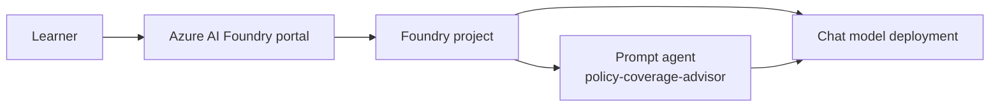

# Module 01 — Foundations + first prompt agent

**Session 1 of 8** introduces Microsoft Foundry through the insurance storyline and gets learners to a working, testable prompt agent in the Azure AI Foundry portal.

## Audience and delivery style

- **Audience:** mixed business stakeholders and developers
- **Delivery mode:** **portal-first**
- **Assumption:** the shared [`foundation/`](../../foundation/) deployment already exists in your sandbox

## Prerequisites

Complete the course prerequisites first: [../../course/prerequisites.md](../../course/prerequisites.md)

You also need:

- Access to the deployed Foundry account and project from the shared foundation
- A chat model deployment created by the foundation Bicep
- Permission to create prompt agents in the Foundry project

## Learning objectives

By the end of this module, learners will be able to:

1. Explain what Microsoft Foundry is and how the **account**, **project**, **model deployment**, and **portal playground** fit together.
2. Describe the core agent building blocks for this course: **instructions**, **model**, **tools** (preview only here), **threads/conversations**, and **runs/responses**.
3. Create a first prompt agent named **`policy-coverage-advisor`** with a simple insurance assistant persona.
4. Test that agent in the Foundry playground with realistic insurance questions.
5. See how this first agent evolves across the remaining seven modules.

## Module architecture

## What this module assumes

This module is the first instructional session, so it does **not** assume prior module completion. It assumes only that the shared foundation has already been deployed:

- Foundry account
- Foundry project
- Foundry endpoint
- Chat model deployment

These values come from the foundation outputs:

- `foundryAccountName`
- `foundryProjectName`
- `foundryEndpoint`
- `chatModelDeploymentName`

## What is new in this module

This module introduces:

- The Foundry portal experience
- Foundry account/project/model vocabulary
- The idea of a declarative **prompt agent**
- A first insurance assistant that relies on **instructions only**

This module **does not** yet add:

- Tools or toolbox composition (Module 02)
- Search grounding or citations (Module 03)
- Multi-agent orchestration (Module 04)
- Managed memory (Module 05)
- Identity and OBO flows (Module 06)
- Observability and evaluation (Module 07)
- APIM/private networking overlay (Module 08)

## Insurance storyline for this session

The course arc builds toward an insurance solution with multiple roles. In Session 1, learners start with the simplest useful persona:

- **Agent:** `policy-coverage-advisor`
- **Role:** answer general policy coverage questions in plain English
- **Scope:** generic guidance only, based on instructions
- **Not yet included:** tools, retrieval, citations, or customer-specific adjudication

That simplicity is intentional: learners see the smallest working agent before layering on enterprise patterns later.

## How this module fits into the full 8-session arc

| Module | Focus | How it extends this session |
| --- | --- | --- |
| 01 | Foundations + first prompt agent | Start here with a simple instruction-only insurance assistant |
| 02 | Tools, Skills & toolbox | Add managed tools and reusable capability packaging |
| 03 | Search grounding / Foundry IQ | Add policy corpus grounding and citations |
| 04 | Hosted agents + orchestration | Split work across specialist agents |
| 05 | Managed Memory + privacy | Add user-scoped memory and privacy controls |
| 06 | Identity, RBAC, auth & OBO | Connect agent actions to enterprise identity |
| 07 | Observability, evaluation, trust & safety | Measure and harden the solution |
| 08 | APIM + networking capstone | Add enterprise gateway and private-network overlay |

## Module assets

- [slides.md](slides.md) — presenter deck
- [demo-runbook.md](demo-runbook.md) — instructor click path and optional script path
- [lab.md](lab.md) — learner exercise
- [deploy.ps1](deploy.ps1) — optional accelerator for creating/updating the prompt agent
- [verify.ps1](verify.ps1) — read-only verification
- [cleanup.ps1](cleanup.ps1) — remove only this module's prompt agent

## Microsoft Learn references

- [Microsoft Foundry overview](https://learn.microsoft.com/azure/foundry/what-is-foundry)
- [Microsoft Foundry Agent Service overview](https://learn.microsoft.com/azure/foundry/agents/overview)
- [Quickstart: Create a prompt agent](https://learn.microsoft.com/azure/foundry/agents/quickstarts/prompt-agent)
- [Microsoft Foundry Playgrounds](https://learn.microsoft.com/azure/foundry/concepts/concept-playgrounds)
- [Get started with Microsoft Foundry SDKs and endpoints](https://learn.microsoft.com/azure/foundry/how-to/develop/sdk-overview?pivots=programming-language-python)

## Success criteria

You are successful in this module when:

- the foundation project is visible in the portal,
- the `policy-coverage-advisor` prompt agent exists,
- the agent answers sample insurance questions in the playground,
- and learners can explain what changes in later modules.
