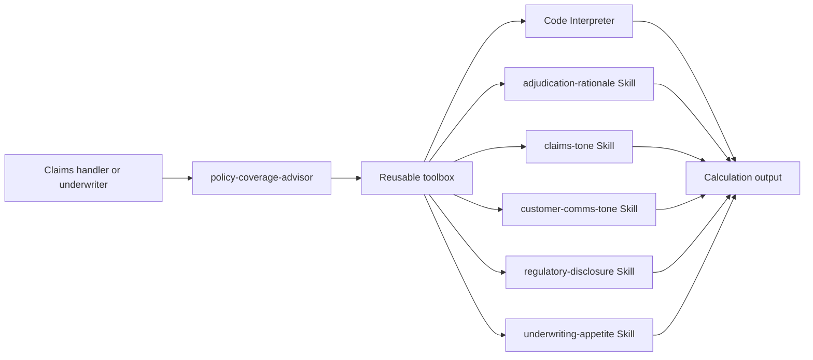

# Module 2 - Tools, Skills & toolbox

Module 2 extends the **policy-coverage-advisor** from Module 1 by attaching a reusable toolbox.
The toolbox bundles one built-in tool (**Code Interpreter**) and five reusable **Skills** that
shape how the agent communicates and reasons in an insurance workflow.

> This module is intentionally **portal-first**. The PowerShell and Python assets are optional
> accelerators for repeatable demos; they aren't required for teaching the concepts.

## What learners build

- Understand the difference between an **agent prompt**, a **tool**, a **Skill**, and a
  **toolbox**.
- Attach **Code Interpreter** so the agent can perform simple premium, excess, and payable
  calculations.
- Attach reusable Skills for:
  - **adjudication rationale** for structured coverage reasoning
  - claimant-friendly **claims tone**
  - **customer communications tone** for plain-English external messaging
  - **regulatory disclosure** and human-review language
  - **underwriting appetite** framing for accept / refer / decline guidance
- Reuse the same toolbox with more than one agent later in the course.

## Learning objectives

By the end of this session, learners can:

1. Explain when to use built-in tools versus prompt-only behavior.
2. Describe what Skills are and why versioned `SKILL.md` files improve reuse and consistency.
3. Explain the toolbox concept as a reusable bundle of tools and Skills.
4. Extend the earlier **policy-coverage-advisor** with a toolbox in the Azure AI Foundry portal.
5. Recognize setup requirements and cost/compliance implications for built-in grounding tools.

## Relationship to Module 1

Module 1 introduced a prompt-only **policy-coverage-advisor**. Module 2 keeps that same agent and
adds capabilities instead of replacing it:

- **same agent purpose**: answer policy coverage questions in the insurance storyline
- **new behavior**: better tone, disclosure, and underwriting guidance through Skills
- **new capability**: simple calculations through Code Interpreter
- **new packaging model**: a reusable toolbox instead of copying instructions into every agent

If Module 1 content isn't present in your local checkout yet, treat `policy-coverage-advisor` as a
previously created prompt agent in your own Foundry project.

## Architecture



## Built-in tools covered in this module

This session focuses on **Code Interpreter** in the live build, while introducing the other
grounding tools conceptually so learners know when they need extra setup.

| Tool | What it does | What it requires | Notes |
| --- | --- | --- | --- |
| Code Interpreter | Runs Python in a sandbox for calculations, tables, and charts | Tool enabled on the agent or toolbox | Useful here for premium, excess, deductible, and payable examples |
| File Search | Grounds the agent in uploaded files / vectorized content | Uploaded files, a vector store, and backing search configuration | Covered hands-on later when the course moves into grounding patterns |
| Web Search / Bing grounding | Retrieves public web content for current facts | Appropriate web-search access and acceptance of cost/compliance implications | Do not assume it's already enabled in a learner sandbox |

## Why Skills instead of a longer system prompt?

Skills help separate **reusable behavior** from the agent's core role:

- the agent stays focused on *coverage guidance*
- the Skills carry portable behaviors like *tone*, *disclosure*, and *decision framing*
- versioning makes changes safer and more auditable
- the same Skills can be attached to multiple agents without reauthoring prompts

## Why a toolbox?

A toolbox gives you one named, reusable package of:

- built-in tools
- external tools or connections
- Skills

That means future agents can reference the same curated set of capabilities rather than
reconfiguring each tool and Skill one-by-one.

## Files in this module

| File | Purpose |
| --- | --- |
| [`slides.md`](slides.md) | Presenter deck |
| [`demo-runbook.md`](demo-runbook.md) | Portal-first instructor demo |
| [`lab.md`](lab.md) | Learner exercise |
| [`deploy.ps1`](deploy.ps1) | Idempotent toolbox provisioning wrapper |
| [`verify.ps1`](verify.ps1) | Read-only checks |
| [`cleanup.ps1`](cleanup.ps1) | Detach and remove module-owned assets |
| [`config.example.json`](config.example.json) | Placeholder local configuration |
| [`src/toolbox.yaml`](src/toolbox.yaml) | Toolbox definition |
| [`src/skills/`](src/skills/) | Five sanitized Skill definitions |
| [`src/provision_toolbox.py`](src/provision_toolbox.py) | Creates or updates Skills and toolbox |
| [`tests/test_toolbox_yaml.py`](tests/test_toolbox_yaml.py) | Offline YAML/content validation |

## Suggested flow for delivery

1. Remind the audience what Module 1 built.
2. Show the problem with prompt-only reuse.
3. Add Code Interpreter.
4. Add Skills.
5. Show the toolbox as the reusable packaging layer.
6. Run a few prompts that clearly demonstrate richer behavior.
7. Preview Module 3: grounding with Azure AI Search.

## Microsoft Learn references

- [Use Code Interpreter with Microsoft Foundry agents](https://learn.microsoft.com/azure/foundry/agents/how-to/tools/code-interpreter)
- [File search tool for Microsoft Foundry agents](https://learn.microsoft.com/azure/foundry/agents/how-to/tools/file-search)
- [Use web search tool in Foundry Agent Service](https://learn.microsoft.com/azure/foundry/agents/how-to/tools/web-search)
- [Use skills with Microsoft Foundry agents (preview)](https://learn.microsoft.com/azure/foundry/agents/how-to/tools/skills)
- [What is Toolbox in Microsoft Foundry?](https://learn.microsoft.com/azure/foundry/agents/concepts/toolbox-overview)
- [Create and manage a toolbox in Microsoft Foundry](https://learn.microsoft.com/azure/foundry/agents/how-to/tools/toolbox)
- [Quickstart: Build a toolbox and use it with a hosted agent](https://learn.microsoft.com/azure/foundry/agents/quickstarts/quickstart-toolbox-agent)

## Local setup

Copy `config.example.json` to `config.json`, replace the placeholders with your own values, and
then use either:

- the portal steps in [`demo-runbook.md`](demo-runbook.md), or
- the optional scripts:

```powershell
# Optional script prereqs:
#   python -m pip install azure-ai-projects azure-identity

Copy-Item .\config.example.json .\config.json
.\deploy.ps1 -WhatIf
.\deploy.ps1
.\verify.ps1
```

## Next module

Module 3 adds **Azure AI Search grounding** so the same insurance storyline moves from prompt +
behavior shaping into document-backed answers with citations.
