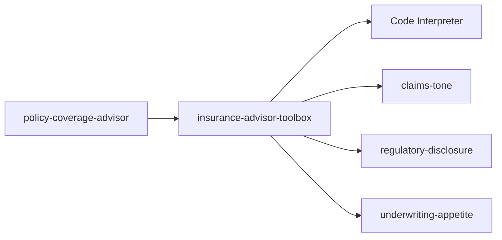

# Slide 1 - Module 2: Tools, Skills & toolbox

- Session 2 of 8 in the Microsoft Foundry insurance storyline
- We extend the **policy-coverage-advisor** from Module 1
- Goal: move from prompt-only behavior to reusable capabilities

---

# Slide 2 - Where we left off

- Module 1 created a prompt-based **policy-coverage-advisor**
- It could answer policy questions, but everything lived in one agent prompt
- That works for a first demo, but it doesn't scale well across agents

---

# Slide 3 - What is a tool?

- A tool gives the agent a capability beyond plain text generation
- Examples:
  - Code Interpreter
  - File Search
  - Web Search / Bing grounding
  - custom functions and APIs
- Tools help the model **do** something, not just **say** something

---

# Slide 4 - Built-in tools in this course

- **Code Interpreter**
  - sandboxed Python
  - math, data shaping, tables, charts
- **File Search**
  - grounds on uploaded content / vectorized documents
  - needs files + search backing
- **Web Search**
  - pulls current public-web facts
  - has cost and compliance implications

---

# Slide 5 - What is a Skill?

- A Skill is a reusable, versioned `SKILL.md`
- It captures behavior, policy, or style guidance once
- You attach it to agents directly or through a toolbox
- Good for:
  - tone
  - decision policy
  - escalation rules
  - formatting conventions

---

# Slide 6 - Why Skills matter

- Keeps the base agent prompt smaller and cleaner
- Encourages reuse across multiple agents
- Makes updates safer through versioning
- Creates a clearer split between:
  - **agent role**
  - **shared behaviors**

---

# Slide 7 - What is a toolbox?

- A toolbox is a named, reusable bundle of:
  - tools
  - Skills
  - other connections or MCP-backed capabilities
- Multiple agents can reference the same toolbox
- Change the bundle once, then reuse it everywhere

---

# Slide 8 - Module 2 architecture

---

# Slide 9 - Demo plan

1. Open the existing prompt agent
2. Add Code Interpreter
3. Create three Skills from `SKILL.md` files
4. Create a toolbox that bundles them
5. Attach the toolbox to the agent
6. Re-run prompts and compare behavior

---

# Slide 10 - Example before vs. after

Before:

- generic wording
- inconsistent disclosure
- no reusable packaging

After:

- empathetic claims tone
- explicit basis / uncertainty / human-review footer
- underwriting responses framed as accept / terms / refer / decline
- simple calculation tasks handled by Code Interpreter

---

# Slide 11 - Sample prompts

- "For a claim of 1,250 with a 250 excess, what is the net payable?"
- "Rewrite this decision for a customer who just had water damage."
- "Based on this submission summary, should we accept, refer, or decline?"
- "Explain the answer with basis, uncertainty, and human review."

---

# Slide 12 - Key takeaways

- Tools add **capability**
- Skills add **reusable behavior**
- Toolboxes add **packaging and reuse**
- This pattern is better than copying the same instructions into every agent

---

# Slide 13 - What to watch for in real projects

- Tool setup prerequisites and RBAC
- Added cost for certain tools
- Public-web grounding compliance boundaries
- Version discipline for reusable Skills
- Reuse strategy across multiple agents

---

# Slide 14 - Next up: Module 3

- We move from behavior shaping into **grounding**
- Add Azure AI Search to policy wording content
- Return answers with citations
- Keep the same insurance storyline and build forward
