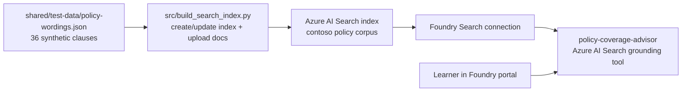

# Module 03 — Azure AI Search grounding / Foundry IQ patterns

**Session 3 of 8** upgrades the existing **`policy-coverage-advisor`** from Modules 1-2 so it stops answering from instructions alone and starts grounding answers in a real policy corpus.

This module stays **portal-first** for a mixed audience. Scripts are included as optional accelerators for repeatable setup and verification.

## Why this module matters

In Modules 1-2, the agent can sound confident even when it is only reasoning from its prompt and attached Skills. In Session 3, learners see the difference between:

- **unguarded generation** — plausible but uncited coverage guidance
- **grounded retrieval** — answers that point back to real synthetic policy clauses
- **agent-runtime orchestration** — the runtime decides when to retrieve, what to cite, and how to blend search results into the answer

That pattern is the heart of this session.

## Learning objectives

By the end of this module, learners will be able to:

1. Explain why grounding matters for insurance questions where clause wording, limits, exclusions, and conditions must be cited.
2. Provision an **Azure AI Search** service and index the shared synthetic policy corpus in `shared/test-data/policy-wordings.json`.
3. Connect Azure AI Search to the Foundry project and attach the **Azure AI Search** grounding tool to **`policy-coverage-advisor`**.
4. Demonstrate grounded answers that cite clause IDs and section references from the policy corpus.
5. Describe the **Foundry IQ** pattern conceptually as retrieval-backed grounding orchestrated by Foundry Agent Service, while deferring exact current product scope and portal labels to Microsoft Learn.

## Relationship to Modules 1-2

This module assumes:

- Module 1 created the prompt agent **`policy-coverage-advisor`**
- Module 2 optionally attached a toolbox and Skills to that same agent

Session 3 **keeps the same agent** and adds one more capability: **grounding against policy wording**.

| Earlier module | What it added | What Session 3 adds on top |
| --- | --- | --- |
| Module 1 | Prompt-only insurance assistant | Real clause-backed evidence |
| Module 2 | Skills and optional toolbox reuse | Search-backed retrieval + citations |

## Architecture



## What learners build

- A **Basic-tier Azure AI Search** service for this module
- A search index containing the synthetic Contoso Home, Motor, and Liability wording corpus
- A Foundry project connection that points to the Search service
- A grounded version of **`policy-coverage-advisor`** that can cite clause IDs such as `HOME-2-3` or `LIAB-6-2`

## The dataset and indexing approach

The corpus is already provided in this repo:

- [`../../shared/test-data/policy-wordings.json`](../../shared/test-data/policy-wordings.json)

This dataset is already clause-shaped, so the module treats **each JSON record as a retrieval chunk**. The index schema keeps the original insurance structure visible to learners:

- `id`
- `product`
- `policy_form`
- `section_ref`
- `clause_type`
- `title`
- `content`
- `content_vector` *(optional vector field placeholder for vector/hybrid retrieval patterns)*

## What “Foundry IQ” means in this module

In this course, **“Foundry IQ pattern”** is used as a teaching shorthand for:

1. indexing trusted source content,
2. connecting that content to a Foundry project,
3. letting the agent runtime retrieve the most relevant passages,
4. and asking the model to answer **with citations instead of guesswork**.

For this session, the implementation path is **direct Azure AI Search grounding**. Microsoft also documents a managed knowledge-base experience under **Foundry IQ**. Because these grounding experiences continue to evolve, use Microsoft Learn as the source of truth for:

- current portal labels,
- preview versus generally available status,
- supported agent environments,
- and exact setup steps.

See:

- [Connect an Azure AI Search index to Foundry agents](https://learn.microsoft.com/azure/foundry/agents/how-to/tools/ai-search)
- [Connect Agents to Foundry IQ Knowledge Bases](https://learn.microsoft.com/azure/foundry/agents/how-to/foundry-iq-connect)
- [Build with runtime components in Foundry Agent Service](https://learn.microsoft.com/azure/foundry/agents/concepts/runtime-components)

## Portal-first teaching flow

1. Revisit the existing **policy-coverage-advisor** from Modules 1-2.
2. Ask a clause-specific question and point out the hallucination risk when no corpus is attached.
3. Create or confirm the Azure AI Search service.
4. Build the search index from the shared policy corpus.
5. Add the Search connection in the Foundry project.
6. Attach the Azure AI Search grounding tool to the agent.
7. Re-run the same questions and show clause-backed answers.

## Files in this module

| File | Purpose |
| --- | --- |
| [slides.md](slides.md) | Presenter deck for Session 3 |
| [model-demo-guide.md](model-demo-guide.md) | Slide-linked instructor context and timed live exemplar |
| [demo-runbook.md](demo-runbook.md) | Portal-first walk-through with optional script path |
| [lab.md](lab.md) | Learner exercise: add a clause, re-index, validate grounded retrieval |
| [deploy.ps1](deploy.ps1) | Idempotent setup wrapper with `-WhatIf` support |
| [verify.ps1](verify.ps1) | Read-only checks for index, connection, and agent tool attachment |
| [cleanup.ps1](cleanup.ps1) | Detach grounding and remove only module-owned Search assets |
| [config.example.json](config.example.json) | Sanitized local configuration template |
| [infra/search.bicep](infra/search.bicep) | Minimal Search service Bicep |
| [src/build_search_index.py](src/build_search_index.py) | Create/update index and upload documents |
| [src/connect_search_to_agent.py](src/connect_search_to_agent.py) | Create/update Search connection and attach/detach grounding tool |
| [tests/test_index_schema.py](tests/test_index_schema.py) | Offline schema coverage test |

## Local setup

Copy `config.example.json` to `config.json`, replace the placeholders with your own values, and then either follow the portal steps in the runbook or use the optional scripts:

```powershell
Copy-Item .\config.example.json .\config.json
.\deploy.ps1 -WhatIf
.\deploy.ps1
.\verify.ps1
```

## Grounded demo prompts

Use prompts that clearly benefit from source-backed wording.

### Prompt 1 — escape of water + trace and access

> A washing machine leak damaged the kitchen floor. Do we only pay for the damage, or can the policy also cover opening up the building to find the leak?

Expected grounded answer themes:

- cites **`HOME-2-3`** for escape of water
- cites **`HOME-2-4`** for trace and access
- mentions the **USD 5,000** trace-and-access limit and the higher water-loss excess

### Prompt 2 — food delivery use on a motor policy

> The insured was delivering food for an app when the crash happened. Is own-damage cover still available?

Expected grounded answer themes:

- use classes definition in **`MOTOR-1-1`**
- hire or reward exclusion in **`MOTOR-5-1`**
- Section B minimum legal liability caveat may still remain

### Prompt 3 — slip on a wet floor

> A customer slipped on a wet floor in a shop. What policy wording matters most?

Expected grounded answer themes:

- occupiers duty / cleaning regime wording in **`LIAB-2-3`**
- wet floor management condition precedent in **`LIAB-6-2`**

## Microsoft Learn references

- [Introduction to Azure AI Search](https://learn.microsoft.com/azure/search/search-what-is-azure-search)
- [Create a Search index in Azure AI Search](https://learn.microsoft.com/azure/search/search-how-to-create-search-index)
- [Vector search overview in Azure AI Search](https://learn.microsoft.com/azure/search/vector-search-overview)
- [Quickstart: Vector search in Azure AI Search](https://learn.microsoft.com/azure/search/search-get-started-vector)
- [What is Microsoft Foundry Agent Service?](https://learn.microsoft.com/azure/foundry/agents/overview)
- [Connect an Azure AI Search index to Foundry agents](https://learn.microsoft.com/azure/foundry/agents/how-to/tools/ai-search)
- [Add a new connection to your project](https://learn.microsoft.com/azure/foundry/how-to/connections-add)
- [Connect Agents to Foundry IQ Knowledge Bases](https://learn.microsoft.com/azure/foundry/agents/how-to/foundry-iq-connect)

## Success criteria

You are successful in this module when:

- the Search service exists and is tagged for this course,
- the policy corpus is indexed with a document count greater than zero,
- the Foundry project has a Search connection for the module,
- the **`policy-coverage-advisor`** agent references the Azure AI Search tool,
- and the agent can answer sample questions with clause-aware grounding instead of prompt-only reasoning.

## Next module

Module 4 introduces **hosted agents + multi-agent orchestration** so the grounded coverage advisor can work alongside specialist agents instead of acting alone.
