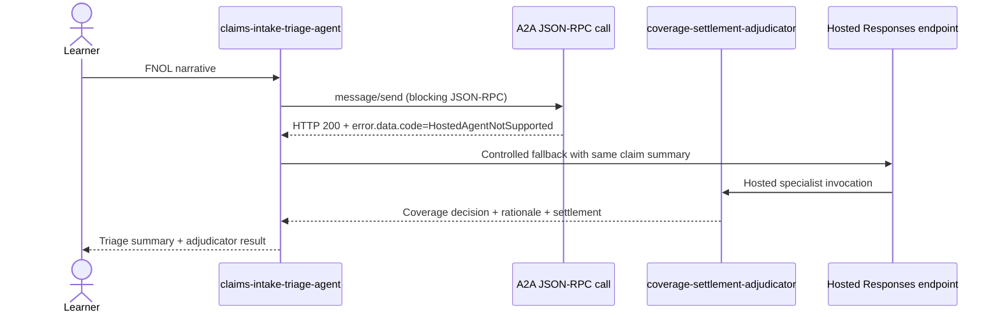

# Session 4 - Hosted agents + multi-agent orchestration

Session 4 introduces the first **hosted** agents in the course. Unlike the prompt agents from
modules 1-3, these agents are built in **Python**, run inside a managed hosted runtime, and are
typically deployed from an `azd` project that packages Agent Framework code into a containerized
service behind Microsoft Foundry Agent Service.

## What you will learn

- How hosted agents differ from prompt agents in packaging, deployment, and runtime behavior.
- How a **claims-intake-triage-agent** orchestrator delegates specialist work to a
  **coverage-settlement-adjudicator** agent.
- How Foundry A2A uses a **JSON-RPC** envelope and why HTTP status alone is not enough.
- How to detect the verified `HostedAgentNotSupported` limitation and fail over to the hosted
  **Responses** endpoint safely and intentionally.

## Prerequisites

- Complete modules 1-3 first.
- Read the shared [foundation README](../../foundation/README.md).
- Copy `config.example.json` to `config.json` and replace all placeholders with your own values.

## Architecture



> [!IMPORTANT]
> **Verified limitation**
>
> A hosted-to-hosted A2A call can return **HTTP 200** while the JSON-RPC body contains an
> `error` envelope with `data.code = HostedAgentNotSupported`. Treating HTTP 200 as success is a
> bug in this scenario. Your orchestrator must inspect the JSON payload and trigger a controlled
> fallback to the hosted Responses protocol only for that specific condition.

## Prompt agents vs hosted agents

| Topic | Prompt agent (modules 1-3) | Hosted agent (this module) |
| --- | --- | --- |
| Authoring surface | Prompt definition in Foundry | Python code with Agent Framework |
| Deployment | Portal-first authoring and versioning | `azd` project, remote build, managed hosting |
| Runtime shape | Prompt/tool orchestration | Long-lived hosted service with protocols |
| Best fit | Fast prototyping, demos, native prompt orchestration | Custom orchestration, code-based logic, packaging, observability |
| Multi-agent pattern | Great for native A2A demos | Great for orchestrators and specialists, but mind the current A2A limitation |

## What the code in this module demonstrates

This module does **not** call Azure during tests. Instead, it gives you a small offline teaching
package under `src/`:

- `src/triage_agent/a2a_client.py`
  - `is_hosted_agent_not_supported(response_json)` inspects the JSON-RPC envelope.
  - `call_adjudicator_via_a2a(...)` posts a blocking JSON-RPC request and raises a typed
    `HostedAgentNotSupportedError` only for the verified limitation.
  - `invoke_with_fallback(...)` retries through the hosted Responses path only for that typed case.
- `src/triage_agent/orchestrator.py`
  - simple FNOL routing helper that demonstrates where the adjudicator call plugs in.
- `src/adjudicator_stub/respond.py`
  - offline specialist stub so demos and tests run without any network dependency.

## Why the fallback matters

The orchestrator pattern here is intentionally conservative:

1. Send a blocking A2A JSON-RPC `message/send`.
2. Inspect the JSON body even when the HTTP status is 200.
3. If—and only if—the body indicates `HostedAgentNotSupported`, derive the hosted Responses URL.
4. Call the hosted specialist over Responses and log that the fallback path was used.
5. Propagate any **other** JSON-RPC error instead of silently retrying.

That preserves the key teaching point: **body-level protocol semantics matter more than transport
status for JSON-RPC orchestration**.

## Portal-visible outcomes

Even though this is the most code-heavy module, learners should still watch the Foundry portal:

- both hosted agent deployments appear in the project
- the hosted agent names and descriptions are visible
- runtime traces/logs can show the A2A attempt and the controlled fallback
- later modules can evaluate the same orchestration flow with the dataset created here

## Files in this module

| File | Purpose |
| --- | --- |
| `README.md` | Session overview and architecture |
| `slides.md` | Speaker deck for the session |
| [`model-demo-guide.md`](model-demo-guide.md) | Slide-linked instructor context and timed live exemplar |
| `demo-runbook.md` | Live demo walkthrough |
| `lab.md` | Hands-on exercise |
| `deploy.ps1` | Prints learner-run `azd` commands after validating `config.json` |
| `verify.ps1` | Read-only best-effort listing of hosted agents |
| `cleanup.ps1` | Scoped `azd down` guidance for this module's environment only |
| `src/` | Offline Python teaching implementation |
| `tests/` | Stdlib `unittest` coverage for the fallback contract |
| `eval/triage-eval-dataset.json` | Starter evaluation cases reused in module 7 |

## Suggested teaching flow

1. Re-anchor on prompt agents from modules 1-3.
2. Introduce hosted agents and Agent Framework.
3. Show the orchestrator + specialist split.
4. Highlight the **verified limitation** before showing any demo.
5. Walk the fallback test first.
6. Then demo the hosted deployment flow conceptually with `azd`.

## Microsoft Learn references

- [What is Microsoft Foundry Agent Service?](https://learn.microsoft.com/en-us/azure/foundry/agents/overview)
- [Agent Framework documentation hub](https://learn.microsoft.com/en-us/agent-framework/)
- [Host your agent with Agent Framework](https://learn.microsoft.com/en-us/agent-framework/get-started/hosting)
- [Connect to an A2A agent endpoint from Foundry Agent Service](https://learn.microsoft.com/en-us/azure/foundry/agents/how-to/tools/agent-to-agent)

If Microsoft Learn reorganizes the A2A pages, start at the Agent Service overview and follow the
current **A2A / agent-to-agent** guidance from there.

## Offline validation

From this module folder:

```powershell
python -m unittest discover -s tests -p "test_*.py" -v
```

That test suite proves the central rule of the module:

- normal JSON-RPC success **does not** fall back
- `HostedAgentNotSupported` **does** fall back
- unrelated JSON-RPC errors are **not** treated as fallback triggers
