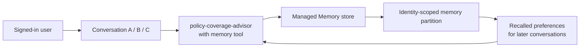

# Module 05 — Managed Memory + user scope/privacy

**Session 5 of 8** extends the existing **`policy-coverage-advisor`** prompt agent with
**managed Memory** so it can recall durable user preferences across conversations while keeping
that memory isolated to the signed-in user identity.

> [!IMPORTANT]
> This module intentionally **extends `policy-coverage-advisor`** from earlier sessions instead of
> creating a brand-new agent. That keeps the insurance storyline continuous: the same advisor now
> becomes more personal, but still respects privacy boundaries.

## Audience and delivery style

- **Audience:** mixed business stakeholders and developers
- **Delivery mode:** **portal-first**
- **Assumption:** the shared public [`foundation/`](../../foundation/) project already exists

## Learning objectives

By the end of this module, learners will be able to:

1. Explain what **managed Memory** is in Foundry Agent Service: durable, cross-conversation
   preference/fact recall for an agent.
2. Describe the **scope model**: memories are isolated per signed-in Microsoft Entra identity,
   rather than shared across all users.
3. Attach a Memory store to the existing **`policy-coverage-advisor`** agent.
4. Demonstrate a simple preference flow, such as “I prefer settlement summaries in bullet points,”
   then verify recall in a brand-new conversation.
5. Show how to inspect and clear one user's memory as a privacy / right-to-erasure exercise.
6. Recognize current preview limitations and validate behavior against current Microsoft Learn
   documentation before presenting it as platform fact.

## Why this module matters

Without memory, every new conversation starts cold. With managed Memory, the advisor can remember
stable presentation preferences or workflow habits across conversations, such as:

- preferred output structure
- preferred currency display
- a request to keep summaries concise

This is useful personalization, but it introduces privacy and governance questions. The module
therefore teaches **both** personalization **and** erasure.

## Module architecture

## What is managed Memory in this course?

For this curriculum, treat managed Memory as:

- **long-term memory**
- **durable across conversations**
- **scoped to the signed-in user identity**
- **appropriate for low-risk preferences and recurring presentation habits**

Examples used in this module are intentionally low-risk and synthetic:

- “Use bullet points for settlement summaries.”
- “Put recommended next steps at the end.”
- “Use USD when you show example figures.”

## Scope and privacy model

The key learning point is **scope**:

- a memory written by **User A** is **not** meant to appear for **User B**
- the Memory tool uses a user-specific scope rather than a shared team bucket
- the portal commonly resolves the signed-in identity automatically
- backend or proxy callers may need to pass the effective user scope explicitly

This module does **not** teach storing real customer PII. All examples remain synthetic and safe
for training.

## Preview status and verified limitation

> [!WARNING]
> **Preview, verified behavior as of this reference build:** managed Memory currently requires a
> **public (non-VNet-isolated) Foundry project** in the validated demo pattern this curriculum was
> based on. Do **not** present Memory as VNet-ready here without re-checking the current
> Microsoft Learn docs. This repository's shared foundation is intentionally public, so the module
> fits directly on top of it.

That caveat is important because later modules cover identity and enterprise controls, and learners
should understand that preview capabilities can have narrower networking support than the rest of
the platform.

## What this module adds to the storyline

Earlier modules established a baseline insurance advisor. This session keeps the same agent role:

- **Agent:** `policy-coverage-advisor`
- **New capability:** remembers per-user output preferences across conversations
- **Privacy lesson:** one user's memory can be inspected and cleared without touching another
  user's scope
- **Still out of scope:** real customer PII, production retention policies, and any claim that the
  feature is GA-ready in every networking topology

## Suggested preference storyline

Use a simple insurance-safe example:

1. In conversation 1, the learner says:
   - “I prefer settlement summaries in bullet points.”
   - “Put the likely coverage outcome first.”
   - “Keep explanations under five bullets.”
2. In conversation 2, the learner asks a new claim question.
3. The advisor recalls the user's preferences and formats the response accordingly.

That creates a clean before/after experience without touching sensitive data.

## Module assets

- [slides.md](slides.md) — presenter deck
- [demo-runbook.md](demo-runbook.md) — portal-first demo with privacy steps
- [lab.md](lab.md) — learner exercise
- [deploy.ps1](deploy.ps1) — optional accelerator for creating/attaching the Memory store
- [verify.ps1](verify.ps1) — read-only validation of store + attachment only
- [cleanup.ps1](cleanup.ps1) — detach/delete module-owned Memory assets, with optional targeted
  purge
- [docs/privacy-notes.md](docs/privacy-notes.md) — explicit handling guidance for safe memory use

## Microsoft Learn references

- [What is Microsoft Foundry Agent Service?](https://learn.microsoft.com/azure/foundry/agents/overview)
- [Create and use memory in Foundry Agent Service](https://learn.microsoft.com/azure/foundry/agents/how-to/memory-usage)
- [What is Memory?](https://learn.microsoft.com/azure/foundry/agents/concepts/what-is-memory)

If the exact Memory portal clicks change, use the current **Memory** section of the Microsoft Learn
Agent Service documentation above as the source of truth.

## Success criteria

This module is successful when:

- the existing `policy-coverage-advisor` is attached to a managed Memory store,
- one user can save a preference in one conversation and see it recalled in a later conversation,
- another user does **not** automatically inherit that preference,
- the instructor can show where to inspect or clear one user's memory,
- and the audience understands that preview networking behavior must be revalidated against current
  docs.

## Next module

Module 6 builds on this privacy conversation by moving into **identity, RBAC, auth, and OBO**:
who the user is, what the agent can do on their behalf, and how enterprise access boundaries are
enforced.
