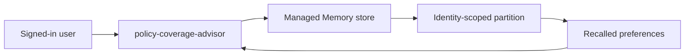

# Slide 1 — Module 5: Managed Memory + user scope/privacy

- Session 5 of 8 in the Microsoft Foundry insurance storyline
- We extend **`policy-coverage-advisor`**
- Goal: personalize across conversations **without** losing privacy discipline

---

# Slide 2 — Where we are in the journey

- Module 1: first prompt agent
- Module 2: tools, Skills, toolbox
- Module 3: grounding and citations
- Module 4: multi-agent orchestration
- **Module 5: memory**

Today we add continuity across conversations.

---

# Slide 3 — What is managed Memory?

- Managed long-term memory for Foundry agents
- Stores durable user preferences and summarized context
- Lets the agent recall relevant facts in later conversations
- Different from thread history:
  - thread history = this conversation
  - managed Memory = future conversations too

---

# Slide 4 — What we are remembering in this module

Safe examples only:

- “Use bullet points for settlement summaries.”
- “Put the likely outcome first.”
- “Keep the answer under five bullets.”

Not safe for this curriculum:

- real customer PII
- bank details
- claim identifiers from live systems
- medical details

---

# Slide 5 — Scope model: per signed-in user

- Memory is **not** a shared team notepad
- It is partitioned by user scope
- In portal-led use, the signed-in identity commonly determines the scope
- In backend scenarios, the caller might pass the effective user scope explicitly

**Key message:** one person's preference should not automatically appear for another person.

---

# Slide 6 — Why privacy matters here

- Personalization is useful
- But persistence creates governance questions
- We must be able to answer:
  - what is stored?
  - for which user?
  - how do we clear it?
  - what should never be stored?

This is the right-to-erasure conversation in mini form.

---

# Slide 7 — Module 5 architecture

---

# Slide 8 — Demo plan

1. Open the existing `policy-coverage-advisor`
2. Enable / attach managed Memory
3. In conversation 1, store a preference
4. Start conversation 2
5. Ask a fresh claim question
6. Observe recall
7. Inspect or clear that user's memory

---

# Slide 9 — Conversation 1: store a preference

Example prompt:

> Remember that I prefer settlement summaries in bullet points and I want the likely coverage outcome first.

What to watch for:

- the agent acknowledges the remembered preference
- the memory tool runs successfully
- no sensitive information is used

---

# Slide 10 — Conversation 2: prove cross-conversation recall

Example prompt:

> A customer reports storm damage to a detached garage. Summarize the likely coverage position.

Expected behavior:

- bullet-point response
- likely outcome appears first
- new conversation, same user

That is the memory moment.

---

# Slide 11 — Privacy controls demo

Show learners that you can:

- inspect the memory store or scope metadata
- target one user's memory for removal
- clear the stored preference
- re-run the question and confirm the preference is gone

Important: verify configuration, not another person's data.

---

# Slide 12 — Preview limitation callout

- Managed Memory is still **preview**
- Verified behavior for this reference build:
  - use a **public** Foundry project for the Memory demo
  - do **not** claim VNet support here without re-checking docs
- Always compare with current Microsoft Learn before teaching it as settled platform behavior

---

# Slide 13 — Key takeaways

- Managed Memory adds durable personalization across conversations
- Scope matters: memory is per user, not automatically shared
- Privacy matters: inspectable, clearable, and deliberately limited
- Good memory content is low-risk preference data, not real PII

---

# Slide 14 — Next up: Module 6

**Identity, RBAC, auth & OBO**

- Who is the caller?
- What can the agent do on their behalf?
- How do enterprise permissions shape tool access?

Module 5 teaches *remembering responsibly*; Module 6 teaches *acting with the right identity*.
