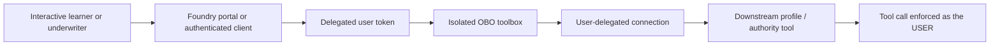
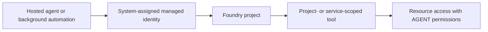

# Module 6 — Identity, RBAC, auth & OBO

**Session 6 of 8** explains how Microsoft Foundry identity choices shape what an insurance agent
can do, who it does it as, and why an isolated on-behalf-of (OBO) path matters for
authority-sensitive tool calls.

## Audience and delivery style

- **Audience:** mixed audience, leaning developer / platform engineer
- **Delivery mode:** **portal-first**, with Bicep and script accelerators
- **Assumption:** the shared [`foundation/`](../../foundation/) deployment already exists

## Learning objectives

By the end of this module, learners will be able to:

1. Explain the difference between **system-assigned managed identity** and **interactive user
   identity** in Foundry.
2. Describe the least-privilege role pattern for Foundry projects and connected resources using:
   - **Azure AI User**
   - **Azure AI Project Manager**
   - **Search Index Data Reader**
   - **Cognitive Services User**
3. Reuse the shared [`../../shared/bicep/rbac-assignment.bicep`](../../shared/bicep/rbac-assignment.bicep)
   module to assign roles safely and repeatably.
4. Explain why OBO belongs in a **separate, isolated toolbox/connection** instead of the shared
   managed-identity tool path.
5. Predict whether an auth context will support OBO before attempting a live tool call.

## Why this matters in the insurance storyline

In earlier modules, agents answered questions, used tools, and recalled user-scoped memory. In
this session, the **underwriting-risk-summarizer** scenario becomes identity-aware:

- routine, non-user-specific operations can run as the **agent's managed identity**
- user-authority checks must run through an **isolated OBO connection**
- the downstream MCP/tool server sees the **signed-in human user's permissions**, not a shared
  service identity

That separation keeps least privilege intact and makes failures easy to reason about.

## Module architecture

### OBO path — user-scoped permissions



### Managed-identity path — non-interactive automation



## Identity comparison

| Topic | Managed identity flow | OBO flow |
| --- | --- | --- |
| Caller | Foundry account / project / hosted agent runtime | Interactive signed-in human user |
| Best use | Background automation, project-level tools, service-to-service access | User-scoped permissions, profile lookups, approval-sensitive actions |
| Token source | Azure-managed service identity | Delegated user token forwarded by Foundry |
| Least-privilege scope | RBAC on project or connected Azure resource | User's existing permissions on the downstream service |
| Predictable failure mode | Missing RBAC on the service identity | No interactive user token available for exchange |

> [!IMPORTANT]
> **Verified limitation:** OBO only works when the caller is an **interactive, signed-in user**
> and a **delegated user token** is available. It does **not** work for application-only or
> service-principal-only execution paths. In that case, the connection fails predictably with a
> "signed-in user required" / "no user token available for OBO exchange" style error. This module's
> [`src/auth_context.py`](src/auth_context.py) captures that rule in offline-testable form.

## Managed identity coverage in this module

This session discusses three managed-identity surfaces:

1. **Foundry account managed identity** — the base service identity on the account.
2. **Foundry project managed identity** — the project-scoped identity used for project-level
   service integrations.
3. **Hosted agent managed identity** — the runtime identity used by hosted agents for
   non-interactive service-to-service access.

The teaching point is not "managed identity versus OBO." It is **where each belongs**:

- use managed identity for platform-owned automation
- use OBO only when the tool must honor the end user's own permissions

## RBAC least-privilege pattern

This module uses a default project scope plus optional per-role narrower scopes:

- assign **Azure AI User** to a learner or app operator who needs to use the Foundry project
- assign **Azure AI Project Manager** only to identities that must manage project assets
- assign **Search Index Data Reader** only at the **specific Search service or index scope** that
  supports grounding
- assign **Cognitive Services User** only where a connected Cognitive Services resource actually
  requires it

The module Bicep keeps the shared assignment logic centralized in
[`../../shared/bicep/rbac-assignment.bicep`](../../shared/bicep/rbac-assignment.bicep) and loops
over the requested roles from [`infra/rbac.bicep`](infra/rbac.bicep).

## Module assets

| File | Purpose |
| --- | --- |
| [`slides.md`](slides.md) | Presenter deck |
| [`demo-runbook.md`](demo-runbook.md) | Portal + Bicep walkthrough |
| [`lab.md`](lab.md) | Hands-on auth-context classifier exercise |
| [`deploy.ps1`](deploy.ps1) | Idempotent RBAC + OBO toolbox provisioning wrapper |
| [`verify.ps1`](verify.ps1) | Read-only verification |
| [`cleanup.ps1`](cleanup.ps1) | Removes only module-owned role assignments and OBO assets |
| [`config.example.json`](config.example.json) | Placeholder configuration |
| [`infra/rbac.bicep`](infra/rbac.bicep) | Module-level RBAC loop template |
| [`src/auth_context.py`](src/auth_context.py) | Offline OBO outcome classifier |
| [`src/provision_obo_toolbox.py`](src/provision_obo_toolbox.py) | Create / verify / cleanup isolated OBO toolbox assets |
| [`tests/test_auth_context.py`](tests/test_auth_context.py) | Unit tests for the classifier |

## Optional local setup

Copy `config.example.json` to `config.json`, replace placeholders with your own sandbox values, and
then use either the portal steps in [`demo-runbook.md`](demo-runbook.md) or the optional scripts:

```powershell
Copy-Item .\config.example.json .\config.json
.\deploy.ps1 -WhatIf
.\deploy.ps1
.\verify.ps1
python -m unittest discover -s tests -p "test_*.py"
```

## Microsoft Learn references

- [Azure AI Foundry RBAC built-in roles](https://learn.microsoft.com/azure/ai-foundry/concepts/rbac-azure-ai-foundry)
- [Azure RBAC built-in roles](https://learn.microsoft.com/azure/role-based-access-control/built-in-roles)
- [Microsoft identity platform — On-Behalf-Of flow](https://learn.microsoft.com/entra/identity-platform/v2-oauth2-on-behalf-of-flow)
- [Managed identities for Azure resources](https://learn.microsoft.com/entra/identity/managed-identities-azure-resources/overview)
- [MCP tool documentation for Foundry agents](https://learn.microsoft.com/azure/foundry/agents/how-to/tools/mcp)
- [What is Toolbox in Microsoft Foundry?](https://learn.microsoft.com/azure/foundry/agents/concepts/toolbox-overview)

## Success criteria

You are successful in this module when:

- learners can distinguish the managed-identity path from the OBO path,
- the least-privilege roles are assigned only where needed,
- the isolated OBO toolbox/connection exists without being mixed into non-user toolchains,
- the classifier correctly predicts that interactive user contexts succeed and
  application/service-principal-only contexts fail.

## Next module

Module 7 turns this identity-aware build into an observable, measurable system with **tracing,
evaluation, optimization, and trust & safety** controls.
