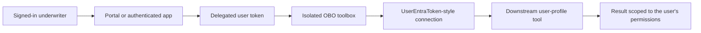
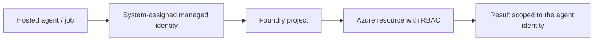

# Slide 1 - Module 6: Identity, RBAC, auth & OBO

- Session 6 of 8
- Theme: **who is the agent acting as?**
- Insurance scenario: underwriting-risk-summarizer needs user-scoped authority checks

---

# Slide 2 - Why identity suddenly matters

- Prior modules focused on prompts, tools, search, orchestration, and memory
- Now we care about:
  - **who** can invoke the agent
  - **which identity** the downstream tool sees
  - **what permissions** are in force at runtime
- In insurance, that distinction affects authority-sensitive actions and auditability

---

# Slide 3 - Three identity surfaces in Foundry

- **Foundry account managed identity**
- **Foundry project managed identity**
- **Hosted agent managed identity**
- Separate from all three: the **interactive signed-in user's identity**
- Key question: should the tool run as the **platform** or as the **person**?

---

# Slide 4 - Managed identity: where it fits

- Best for **non-interactive**, service-to-service access
- No secret rotation
- Clean RBAC story
- Typical uses:
  - project-scoped automation
  - hosted agent calls to Azure resources
  - repeatable background workflows
- Limitation: it is **not** a substitute for user-delegated access

---

# Slide 5 - RBAC roles we use in this module

- **Azure AI User** — use the project
- **Azure AI Project Manager** — manage project assets
- **Search Index Data Reader** — read only the grounding index
- **Cognitive Services User** — call the connected cognitive resource when needed
- Teach the pattern: **assign the narrowest built-in role at the narrowest useful scope**

---

# Slide 6 - Least-privilege assignment pattern

- Default scope: Foundry **project**
- Narrower scopes when possible:
  - Search role on the **Search service / index**
  - Cognitive role on the **specific connected resource**
- Reuse a shared Bicep role-assignment module
- Avoid broad roles like Owner or Contributor for learners

---

# Slide 7 - What OBO is

- **On-Behalf-Of** lets a downstream tool act with the **calling user's delegated token**
- The tool sees the **user's permissions**, not the agent's managed identity
- Use it when the result must reflect **who the user is allowed to see or do**
- Example: underwriting profile / authority / personal work-context lookup

---

# Slide 8 - Why isolate the OBO toolbox

- Keep OBO in a **separate toolbox + connection**
- Benefits:
  - a missing user token does **not** break shared managed-identity tools
  - blast radius stays small
  - teaching story is clearer
  - auditing is simpler
- Isolation is a design choice, not just a packaging choice

---

# Slide 9 - Architecture walkthrough

---

# Slide 10 - Dedicated limitation slide

- **Verified limitation:** OBO requires an **interactive signed-in user**
- It fails for:
  - service principals
  - client-credentials flows
  - headless background jobs with no user token
- Predictable failure mode:
  - "signed-in user required"
  - "no user token available for on-behalf-of exchange"

---

# Slide 11 - Contrast with managed-identity-only flow

- Good for automation
- Wrong choice when the tool must honor the human caller's permissions

---

# Slide 12 - Demo plan

1. Review project roles in the portal
2. Assign least-privilege roles with Bicep
3. Create the isolated OBO connection and toolbox
4. Show success for an interactive user
5. Show predictable failure for an application identity
6. Use the Python classifier as an offline pre-check

---

# Slide 13 - Lab and test asset

- `src/auth_context.py`
  - models the auth context
  - predicts whether OBO should work
- `tests/test_auth_context.py`
  - interactive user succeeds
  - service principal fails
  - non-interactive user fails
  - missing user token fails

---

# Slide 14 - Key takeaways + next module

- Managed identity and OBO solve **different** problems
- Least privilege starts with both **role choice** and **scope choice**
- OBO belongs behind an **isolated** toolbox/connection
- If there is no interactive user token, OBO should be expected to fail

**Next:** Module 7 — observability, evaluation, optimization, trust & safety
