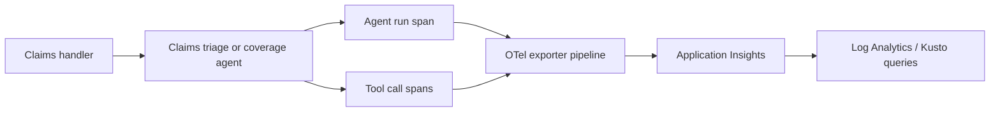
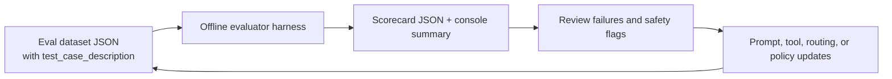

# Module 7 - Observability, evaluation, optimization, trust & safety

Module 7 adds the operating discipline around the insurance storyline: **instrument what the agent is doing, evaluate whether it routes correctly, and enforce simple trust/safety rules before you trust the output**.

This module is intentionally **offline-first** for validation. Learners can run the evaluator and safety checks locally without calling Azure resources. The live-path discussion is included only as an explicit, opt-in extension.

> [!IMPORTANT]
> **Author observability from day one.** The lesson in this module is to wire OpenTelemetry (OTel) spans directly into agent and tool code at authoring time. Treat post-deploy patching as an anti-pattern: it is useful as a rescue technique, but it is not the curriculum's recommended build habit.

## What learners build

- An idiomatic Python OTel helper in [`src/otel_setup.py`](src/otel_setup.py) with:
  - agent-run spans
  - tool-call decorators
  - conditional Azure Monitor exporter wiring
  - graceful no-op behavior when no connection string or package is present
- A rule-based offline evaluator in [`src/evaluator.py`](src/evaluator.py)
- A compatible evaluation dataset in [`eval/triage-eval-dataset.json`](eval/triage-eval-dataset.json)
- Deterministic trust/safety checks in [`src/safety_checks.py`](src/safety_checks.py)
- Unit tests and offline verification scripts suitable for learners and CI

## Learning objectives

By the end of this session, learners can:

1. Explain why telemetry belongs in agent authoring code, not as a last-minute patch.
2. Add spans around an agent run and around individual tool calls.
3. Describe the difference between **trace collection**, **metric collection**, and **evaluation**.
4. Build and extend an evaluation dataset where every case includes `test_case_description`.
5. Run a lightweight offline evaluator and interpret a scorecard.
6. Apply simple trust/safety patterns for grounding, protected-class flagging, and fraud escalation.
7. Use evaluation findings to tighten prompts, tool selection, and routing rules.

## Relationship to earlier modules

This module assumes the insurance narrative already exists:

- **triage** decides whether a claim can be auto-adjudicated, needs manual review, or should escalate for fraud review
- **coverage guidance** must stay grounded in policy wording with citations
- **adjudication** is a specialist capability, even when this module demonstrates it only conceptually and offline

If the earlier module's triage evaluation dataset is not present yet, this module provides its own schema-compatible copy and keeps the route vocabulary aligned with the shared schema:

- `auto-adjudicate`
- `manual-review`
- `fraud-escalation`

## Architecture

### Agent telemetry flow



### Evaluation feedback loop



## Why "observe at authoring time" matters

The hardest observability bugs are often invisible until a demo is already underway. A post-deploy patch script can rescue an already-running service, but it usually means:

- someone forgot the exporter dependency
- spans were never created around the most important work
- `service.name` or role metadata was missing
- external calls were never instrumented, so the trace tree is incomplete

This module deliberately flips that pattern:

1. create spans in code while writing the agent
2. wrap tool functions where they are defined
3. make the exporter conditional, not the instrumentation itself
4. keep offline execution working even when telemetry packages are absent

## Verified field notes (sanitized)

> [!NOTE]
> **Verified field notes** — generalized from a real enterprise build, sanitized for curriculum use.
>
> - **Empty Application Insights is often a network-ingestion issue, not an agent issue.** Agents can appear healthy while telemetry stays empty when ingestion is blocked by a private-ingestion setup that was not completed end-to-end.
> - **RBAC is necessary but not sufficient.** Correct telemetry roles on the running agent identity matter, but network path and exporter wiring still decide whether spans arrive.
> - **Hosted-agent telemetry usually needs explicit OTel code.** Scaffolds frequently run fine without shipping spans until you add exporter setup and HTTP client instrumentation yourself.
> - **APIM token governance does not automatically produce token metrics.** If you want per-workload token reporting, add an explicit token-metric emission policy; do not assume limit policies create FinOps data.
> - **Endpoint/versioning rules can differ across API surfaces.** Prompt-style and hosted-agent response endpoints may require opposite `api-version` behavior, so treat request construction as part of the validation story.
> - **Publishing a new version can matter more than toggling a mutable default.** In some agent-versioning flows, traffic follows the newest published version rather than a simple default switch.
>
> These are included here because they were **verified in the field**, not because learners must reproduce them in this offline module.

## Evaluation approach in this module

The enterprise reference build documented a generated 15-case smoke dataset, an `eval.yaml`, and resumable evaluator-generation metadata, but also hit a workflow time ceiling before a live evaluation run started. This module responds with a simpler teaching pattern:

- keep the dataset in plain JSON
- make every case human-readable through `test_case_description`
- score routing behavior offline with deterministic logic
- reserve live evaluation for an explicit, opt-in extension

That makes the lab repeatable for every learner without waiting on cloud jobs.

## Trust & safety patterns covered here

### 1. Grounding and citation enforcement

If the agent makes a **coverage**, **exclusion**, or **denial** claim, it should cite the relevant clause or section. The rule-based helper in [`src/safety_checks.py`](src/safety_checks.py) flags responses that make policy assertions without a clause-like citation.

### 2. Fraud escalation signaling

The triage flow should identify suspicious narratives and route them to a human fraud process rather than confidently auto-paying or auto-denying them.

### 3. Protected-class flagging

Protected-class language is not a routing feature. If output references age, disability, religion, ethnicity, or similar sensitive traits in a decisioning context, it should be flagged for review.

## Optimization checklist

Use evaluation results as a loop, not as a one-time report:

1. **Read failed cases first.** Do not optimize on aggregate pass rate alone.
2. **Fix the smallest reliable layer.** Prefer routing logic or instruction changes before adding more tools.
3. **Harden tool descriptions.** If the agent calls the wrong tool, adjust tool intent and tool boundaries.
4. **Tighten citation rules.** If grounded answers omit clause IDs, strengthen the instruction and add a negative test.
5. **Re-run the same dataset after every change.** Keep regressions visible.
6. **Separate accuracy from safety.** A case can route correctly and still fail a trust/safety rule.

## Files in this module

| File | Purpose |
| --- | --- |
| [`slides.md`](slides.md) | Presenter deck |
| [`model-demo-guide.md`](model-demo-guide.md) | Slide-linked context and timed instructor exemplar |
| [`demo-runbook.md`](demo-runbook.md) | Step-by-step demo flow |
| [`lab.md`](lab.md) | Learner exercise |
| [`deploy.ps1`](deploy.ps1) | Config validation and OTel wiring guidance |
| [`verify.ps1`](verify.ps1) | Offline evaluator runner and scorecard gate |
| [`cleanup.ps1`](cleanup.ps1) | Removes local generated artifacts only |
| [`config.example.json`](config.example.json) | Placeholder local settings |
| [`src/otel_setup.py`](src/otel_setup.py) | OTel helper module |
| [`src/evaluator.py`](src/evaluator.py) | Offline evaluation harness |
| [`src/safety_checks.py`](src/safety_checks.py) | Deterministic trust/safety checks |
| [`eval/triage-eval-dataset.json`](eval/triage-eval-dataset.json) | Schema-compatible routing dataset |
| [`tests/test_evaluator.py`](tests/test_evaluator.py) | Evaluator unit tests |
| [`tests/test_safety_checks.py`](tests/test_safety_checks.py) | Safety-check unit tests |

## Suggested delivery flow

1. Explain the difference between runtime telemetry and evaluation.
2. Show the anti-pattern: patching observability only after deployment.
3. Introduce [`src/otel_setup.py`](src/otel_setup.py) as the authoring-time pattern.
4. Walk through the sanitized field notes so learners know what breaks in real projects.
5. Run the offline evaluator and inspect the scorecard.
6. Run the safety checks against sample outputs.
7. Close with the optimization checklist.
8. Preview Module 8: APIM, networking, and the operating capstone.

## Microsoft Learn references

- [Enable OpenTelemetry in Application Insights](https://learn.microsoft.com/azure/azure-monitor/app/opentelemetry-enable)
- [Run evaluations from the Microsoft Foundry portal](https://learn.microsoft.com/azure/foundry/how-to/evaluate-generative-ai-app)
- [What is Azure AI Content Safety?](https://learn.microsoft.com/azure/ai-services/content-safety/overview)
- [Create a Foundry resource (Bicep/ARM)](https://learn.microsoft.com/azure/ai-foundry/how-to/create-resource-template)

## Local usage

```powershell
Copy-Item .\config.example.json .\config.json
.\deploy.ps1 -WhatIf
python .\src\evaluator.py --output .\artifacts\scorecard.json
.\verify.ps1 -Threshold 0.85
python -m unittest discover -s .\tests -v
```

## Next module

Module 8 adds **APIM + networking + operate capstone**: private access patterns, gateway controls, and the enterprise-operating overlay around the same insurance scenario.
