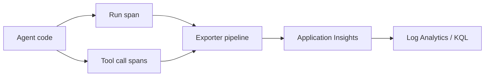

# Slide 1 - Module 7: Observability, evaluation, optimization, trust & safety

- Session 7 of 8 in the insurance storyline
- We shift from "can the agent answer?" to "can we operate it safely and measure it?"
- Focus: OTel, offline evaluation, safety checks, optimization loops

---

# Slide 2 - Why this module matters

- A good demo can still be an unobservable system
- A correct answer can still be unsafe or ungrounded
- A strong prompt can still regress silently over time
- Operating discipline starts before production

---

# Slide 3 - Observe at authoring time, not after deployment

- Put spans in the code where agent work happens
- Wrap tool calls where the functions are defined
- Keep exporter setup optional, not the instrumentation itself
- Treat post-deploy patching as a rescue pattern, not the default build habit

---

# Slide 4 - What to instrument in an agent

- agent run start/end
- each tool invocation
- downstream HTTP or SDK calls
- routing decisions
- safety-review decisions
- major retries or exception paths

---

# Slide 5 - OTel basics for agent workloads

- **TracerProvider** sets the trace pipeline
- **Resource / service.name** separates agent roles cleanly
- **Span processors + exporter** move data to Azure Monitor
- No connection string? Keep the code runnable anyway

---

# Slide 6 - The code pattern in this module

- `configure_otel()` configures a provider once
- `start_agent_run_span(name)` creates a root span for a run
- `@instrument_tool_call` wraps tools consistently
- The module works offline even if Azure Monitor packages are absent

---

# Slide 7 - Telemetry flow

---

# Slide 8 - Verified field notes: why telemetry can stay empty

- Empty App Insights can be a network-ingestion issue, not an agent failure
- RBAC can be correct and telemetry can still fail
- Hosted agents often need explicit exporter wiring and client instrumentation
- Missing service naming turns the map into an unlabeled blob

---

# Slide 9 - Verified field notes: APIM and endpoint traps

- Token-limit policies do not automatically emit token metrics
- Add explicit token-metric emission for FinOps / chargeback stories
- Different response endpoints can have opposite `api-version` rules
- Version routing may follow latest published version, not a mutable default switch

---

# Slide 10 - Evaluation is not tracing

- tracing answers: **what happened?**
- evaluation answers: **was the behavior acceptable?**
- optimization answers: **what should we change next?**
- safety checks answer: **should a human intervene?**

---

# Slide 11 - Dataset design principles

- Keep the dataset in plain JSON for repeatability
- Every case must include `test_case_description`
- Align route labels with the shared schema
- Use realistic insurance FNOL narratives
- Cover both happy path and edge cases

---

# Slide 12 - Offline evaluator harness

- default router is rule-based and fully offline
- optional live-call mode is opt-in only
- outputs a scorecard with:
  - total / passed / failed
  - pass rate
  - per-case actual vs expected route
- suitable for learner laptops and CI

---

# Slide 13 - Trust & safety patterns

- flag protected-class language
- flag fraud-signal keywords
- require clause-like citations for coverage or exclusion claims
- keep these rules explicit in both instructions and tests

---

# Slide 14 - Demo flow

1. Show `src/otel_setup.py`
2. Run the evaluator on `eval/triage-eval-dataset.json`
3. Open the scorecard
4. Run a few sample safety checks
5. Add one new case or rule and re-run

---

# Slide 15 - Optimization checklist

- inspect failed cases before rewriting prompts
- fix one layer at a time
- tighten tool descriptions when routes drift
- add negative tests for unsafe phrasing
- re-run the exact same dataset after each change

---

# Slide 16 - Key takeaways

- instrument first, export second
- offline evaluation lowers friction and catches regressions fast
- trust & safety rules should be explicit and testable
- optimization works best as a loop, not a launch checklist

---

# Slide 17 - Next module teaser

- Module 8: APIM + networking + capstone
- private access patterns
- gateway policy and token visibility
- enterprise operating posture around the full solution
