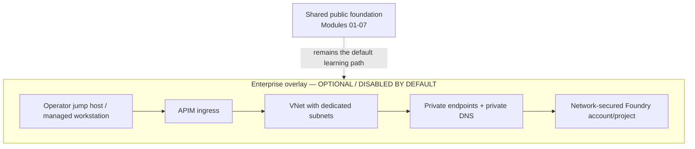

# Module 08 — APIM + private networking + manage/operate capstone

**Session 8 of 8** closes the curriculum by showing how to **front a Foundry model connection with Azure API Management (APIM)**, how to explain the **mandatory BYOM deployment-metadata probe**, and how to operate the whole training environment with consistent tags, ownership, verification, and cost hygiene.

This module stays **portal-first** and **offline-safe by default**. The local verification path uses a tiny mock server so learners can understand the APIM/BYOM contract without calling Azure resources.

## Why this module matters

Earlier modules taught how to build agents, tools, search grounding, orchestration, memory, identity, and observability. A real deployment still needs:

- a **governed ingress** in front of model traffic,
- clear **operator controls** for identity, throttling, and ownership,
- a repeatable **verification routine** across all modules,
- and an honest way to discuss **enterprise private-networking patterns** without silently changing the shared public foundation.

This session ties those threads together.

## Learning objectives

By the end of this module, learners will be able to:

1. Explain why teams front a Foundry **Bring Your Own Model (BYOM)** connection with **APIM**.
2. Describe and review an APIM policy chain that performs **JWT validation**, **token limiting**, **request rewriting**, and **managed-identity backend auth**.
3. Recognize the **verified deployment-metadata probe gotcha**: Foundry validates a BYOM connection with `GET {target}/deployments/{model}` with **no `api-version`**, and it expects an **ARM Cognitive Services deployment resource shape**.
4. Use a **local mock server** to validate the deployment probe contract completely offline.
5. Apply a practical **operate/manage checklist** across all eight modules, including tags, ownership, cost awareness, and verification routines.
6. Distinguish the shared **public foundation** from an **optional, disabled-by-default enterprise overlay** for VNet injection and private endpoints.

## Relationship to earlier modules

| Prior session | Capability it introduced | How this capstone builds on it |
| --- | --- | --- |
| Module 01 | First prompt agent | Routes model access through an operator-governed gateway |
| Module 02 | Skills and toolbox reuse | Applies gateway policy consistently to shared workloads |
| Module 03 | Search grounding / Foundry IQ | Preserves grounded-answer behavior while adding APIM controls |
| Module 04 | Hosted orchestration | Adds gateway and operator checks to multi-agent traffic patterns |
| Module 05 | Managed Memory | Clarifies that Memory has separate networking constraints and should be operated intentionally |
| Module 06 | Identity / RBAC / OBO | Reuses least-privilege thinking for JWT validation and backend identity |
| Module 07 | Observability / evaluation / guardrails | Adds token-budget governance, operator runbooks, and health verification |

## Architecture — APIM as the BYOM gateway

```mermaid
flowchart LR
    client[Client or app<br/>Foundry portal / test client]
    apim[Azure API Management gateway]
    policies[BYOM gateway policy chain<br/>JWT validation<br/>Token limit<br/>Rewrite URI<br/>Managed identity auth]
    probe[Mandatory deployment-metadata probe<br/>GET /deployments/{model}<br/>no api-version]
    connection[Foundry BYOM model connection]
    backend[Foundry model endpoint]

    client --> apim
    apim --> policies
    policies --> probe
    policies --> connection
    connection --> backend
```

## Architecture — optional enterprise overlay (disabled by default)



> [!IMPORTANT]
> **Verified gotcha — preserve this technical detail:** Foundry validates a BYOM connection with `GET {target}/deployments/{model}` and **no `api-version` query string**. The response must look like an **ARM Cognitive Services deployment resource** (`id`, `name`, `type: Microsoft.CognitiveServices/accounts/deployments`, `sku`, `properties.model`, `properties.provisioningState`). If the gateway returns an OpenAI-style deployment object instead, or does not implement the probe at all, downstream calls can fail with a bare **`NotFound`**.

## What learners build in this module

- A **sanitized APIM policy pack** in `infra/apim/`
- A **local deployment-probe mock server** in `src/mock_deployment_probe_server.py`
- An **offline contract test** in `tests/test_deployment_probe_contract.py`
- A **manage/operate checklist** in `docs/operate-checklist.md`
- A **disabled-by-default enterprise overlay** Bicep example in `infra/enterprise-overlay/private-networking.bicep`

## Tagging, ownership, and cost-hygiene guidance

Carry these conventions forward across the full curriculum:

- Tag course-owned resources with `course=foundry-insurance-learning-series`
- Add an ownership tag such as `owner=<team-or-alias>`
- Add a module tag such as `module=08-apim-networking-capstone` for anything created specifically for this capstone
- Keep preview or demo-only assets clearly labelled
- Review APIM token usage, model quotas, and Search/monitoring tiers before long demos
- Use read-only verification scripts before and after live changes

See [docs/operate-checklist.md](docs/operate-checklist.md) for the consolidated operator routine.

## Files in this module

| File | Purpose |
| --- | --- |
| [slides.md](slides.md) | Presenter deck for the capstone session |
| [demo-runbook.md](demo-runbook.md) | Portal-first operator/demo walkthrough |
| [lab.md](lab.md) | Hands-on exercise for the deployment-probe contract |
| [deploy.ps1](deploy.ps1) | Safe deployment guidance script with optional policy-application path |
| [verify.ps1](verify.ps1) | Offline-safe deployment-probe verification plus optional run-all check |
| [cleanup.ps1](cleanup.ps1) | Minimal cleanup guidance with enterprise-overlay gating |
| [config.example.json](config.example.json) | Sanitized local configuration template |
| [infra/apim/foundry-api-policy.xml](infra/apim/foundry-api-policy.xml) | Sanitized API-level APIM policy |
| [infra/apim/get-deployment-operation-policy.xml](infra/apim/get-deployment-operation-policy.xml) | Sanitized mandatory deployment-probe mock policy |
| [infra/enterprise-overlay/private-networking.bicep](infra/enterprise-overlay/private-networking.bicep) | Separate, disabled-by-default private-networking overlay |
| [src/mock_deployment_probe_server.py](src/mock_deployment_probe_server.py) | Local mock server for the BYOM probe contract |
| [tests/test_deployment_probe_contract.py](tests/test_deployment_probe_contract.py) | Offline contract/unit tests |
| [docs/operate-checklist.md](docs/operate-checklist.md) | Module-by-module operating checklist |

## Offline-first quick start

1. Copy `config.example.json` to `config.json`.
2. Review the APIM policy files in `infra/apim/`.
3. Preview the operator plan:

   ```powershell
   Copy-Item .\config.example.json .\config.json
   .\deploy.ps1 -WhatIf
   ```

4. Validate the deployment probe offline:

   ```powershell
   .\verify.ps1
   python -m unittest discover -s tests -p "test_*.py"
   ```

5. Optionally run the capstone “operate” sweep:

   ```powershell
   .\verify.ps1 -RunAllModuleVerifications
   ```

## Teaching notes for the enterprise overlay

The private-networking overlay is intentionally **not wired into** `foundation/bicep/main.bicep`. That separation is the point:

- Modules 01-07 continue to use the shared **public** learning foundation.
- Session 08 introduces the **enterprise concept** without changing the default learning path.
- Operators must explicitly opt in with `-EnableEnterpriseOverlay` and type the confirmation string before the script even prints the networking plan.

## Microsoft Learn references

- [Azure API Management policies reference](https://learn.microsoft.com/azure/api-management/api-management-policies)
- [Validate Microsoft Entra tokens in APIM](https://learn.microsoft.com/azure/api-management/validate-azure-ad-token-policy)
- [Limit large language model token usage in APIM](https://learn.microsoft.com/azure/api-management/llm-token-limit-policy)
- [Authenticate with managed identity in APIM](https://learn.microsoft.com/azure/api-management/authentication-managed-identity-policy)
- [Azure AI Foundry connections](https://learn.microsoft.com/azure/ai-foundry/how-to/connections-add)
- [Private endpoints for Azure AI services](https://learn.microsoft.com/azure/ai-services/cognitive-services-virtual-networks)
- [Azure API Management virtual network concepts](https://learn.microsoft.com/azure/api-management/virtual-network-concepts)
- [Azure Private Link overview](https://learn.microsoft.com/azure/private-link/private-link-overview)

## Success criteria

You are successful in this module when:

- learners can explain the APIM/BYOM gateway pattern,
- the deployment-metadata probe gotcha is memorable and correctly described,
- `verify.ps1` proves the probe contract **offline** with the local mock server,
- `python -m unittest` passes for the deployment contract tests,
- and the enterprise overlay remains clearly **optional** and **disabled by default**.

## Wrap-up

This capstone is intentionally operational. It does not add a brand-new agent feature; it shows how to **govern, verify, and explain** the full learning solution so it can stand up in a real architecture review.
